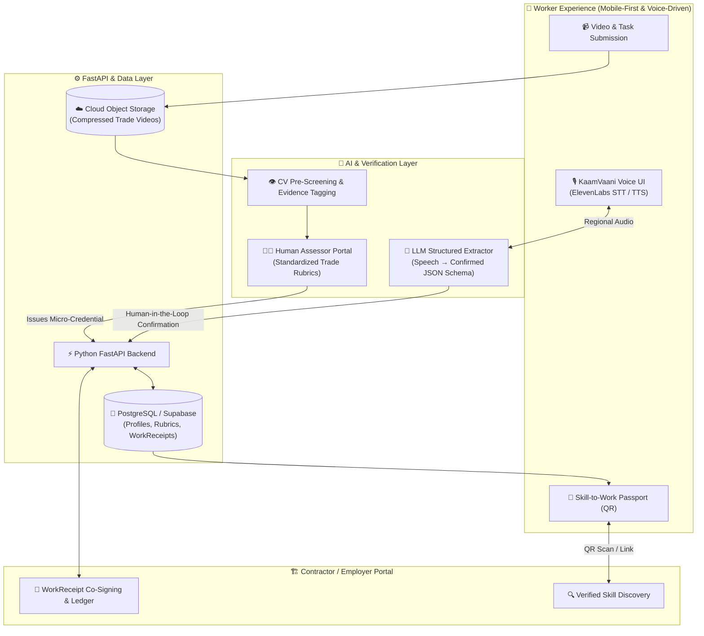

---

## 💡 The Solution: KaamKavach

**KaamKavach** (*"Work Shield"*) bridges the trust and documentation gap through a unified, multilingual platform built specifically for low-literacy, mobile-first tradespeople and the contractors who hire them.

### Core Pillars

| Module | What It Does | Why It Matters |
| :--- | :--- | :--- |
| **1. Hybrid Skill Verification Engine** | Workers submit short practical video demonstrations alongside trade-specific tasks. Computer vision & AI pre-screen and structure the evidence, while **certified human assessors** validate competencies against standardized rubrics to issue granular **micro-credentials**. | Prevents AI hallucinations on physical safety/craftsmanship while keeping assessment scalable and tamper-proof. |
| **2. Skill-to-Work Passport** | A dynamic, portable digital identity combining **practical video proof**, **assessor-backed credentials**, and **verified work logs**—accessible offline or online via a scannable **QR code** or secure link. | Turns an invisible daily-wage laborer into a verifiable professional with a growing, tamper-evident portfolio. |
| **3. KaamVaani (Voice-First Assistant)** | Powered by **ElevenLabs STT/TTS + LLM structured extraction**, workers interact in regional Indian languages via natural speech to build profiles, understand assessment tasks, and log work. Users review and confirm extracted fields before saving. | Eliminates form-fatigue and literacy barriers—no typing or English proficiency required. |
| **4. WorkReceipt (Digital Work Ledger)** | A two-party digital agreement & milestone tracker recording agreed wages, working hours, task scope, extra work, and payment receipts. | Protects workers from wage disputes and builds an indisputable ledger of real-world reliability. |
| **5. Competency-Based Hiring** | Contractors filter and discover workers by **verified micro-credentials**, trade, proximity, and availability rather than unverified word-of-mouth. | Reduces contractor rework/hiring risk while rewarding skilled workers with fair market rates. |

---


<div align="center">

# 🛡️ KaamKavach
### **Your Skills. Your Proof. Your Protection.**

**An AI-powered, voice-first skill verification and digital work-protection ecosystem for India's informal and blue-collar workforce.**

[]()
[]()
[]()
[]()
[]()

*We're not just helping workers find jobs. We're helping them prove their abilities, build their professional reputation, and protect the value of their work.*

</div>

---

## 📊 Impact at a Glance

| 🎯 Target Market | ⚡ Accessibility | 🛡️ Trust & Safety | 📑 Work Protection |
| :---: | :---: | :---: | :---: |
| **~88% (~550M)** | **0% Typing Needed** | **3-Layer Proof** | **100% Digital Trail** |
| Of India's workforce operates outside formal sectors (`31Cr+` on e-Shram) with zero verifiable skill credentials | Voice-first regional onboarding via **KaamVaani** (ElevenLabs STT/TTS) for low-literacy workers | Video Demo + AI Pre-Screening + **Human Assessor Rubric** eliminates false certifications | Co-signed **WorkReceipts** prevent wage theft and build bankable income history |

### 🔄 The Transformation: Before vs. With KaamKavach

| Dimension | ❌ Status Quo (Informal Reality) | ✅ With KaamKavach |
| :--- | :--- | :--- |
| **Proving Skill** | Verbal claims; forced to accept lower daily wages to "prove" ability | **QR Skill-to-Work Passport** with video proof & rubric-backed micro-credentials |
| **Onboarding & UI** | English-heavy forms that exclude skilled, low-literacy tradespeople | **KaamVaani Voice Assistant** converts natural speech into confirmed structured records |
| **Wage & Scope Security** | Unrecorded verbal deals leading to arbitrary deductions & payment delays | **WorkReceipt** logs agreed rates, hours, extra tasks, and acknowledged payouts |
| **Contractor Hiring** | Blind word-of-mouth hiring causing rework, delays, and safety risks | Instant filtering by **verified micro-credentials**, trade, proximity, and availability |

---
## 🚨 The Reality Gap: 450M+ Workers, Zero Verifiable Proof
## 🚨 The Problem

India’s informal sector—electricians, plumbers, masons, carpenters, and construction technicians—powers the nation's infrastructure. Yet, millions of highly skilled tradespeople face two systemic barriers:

1. **The Credibility Trap:** Years of hands-on mastery count for nothing without paper certificates, trapping skilled tradespeople in low-wage, inconsistent daily labor.
2. **The Exploitation Loop:** Without documented agreements on wages, working hours, or scope changes, workers face payment disputes with zero proof of completed work.
**Existing job portals fail this demographic** because they assume literacy, rely on self-reported text résumés, and end their responsibility the moment a phone number is exchanged.

---

## 💡 The Solution: 5 Integrated Pillars

### 1. 🔍 Hybrid Skill Verification Engine
* Workers record short practical task videos and complete trade-specific assessments.
* **Computer Vision & AI** segment procedural steps and flag safety/tool checkpoints to assist review.
* **Qualified Human Assessors** validate competencies against standardized trade rubrics and issue granular **Micro-Credentials**.

### 2. 🪪 Skill-to-Work Passport *(Core Innovation)*
A portable, tamper-evident digital identity shareable via **QR Code or secure link**, unifying three independent pillars of truth:

```text
┌─────────────────────────────────────────────────────────────────────────┐
│                       SKILL-TO-WORK PASSPORT (QR)                       │
├─────────────────────────┬───────────────────────┬───────────────────────┤
│   1. DEMONSTRATED       │   2. INDEPENDENT      │   3. ACKNOWLEDGED     │
│      EVIDENCE           │      VALIDATION       │      WORK HISTORY     │
├─────────────────────────┼───────────────────────┼───────────────────────┤
│ • Practical trade video │ • Standardized rubric │ • WorkReceipt logs    │
│ • Task execution steps  │ • AI pre-analysis     │ • Agreed vs. paid     │
│ • Timestamped proof     │ • Human assessor sign │ • Employer sign-offs  │
└─────────────────────────┴───────────────────────┴───────────────────────┘
```

### 3. 🎙️ KaamVaani — Multilingual Voice Assistant
* Powered by **ElevenLabs (STT & TTS)** + **LLM Structured Extraction**, workers interact in regional Indian languages via natural voice.
* Workers create profiles, hear assessment instructions, and log daily work hands-free—reviewing and confirming extracted cards before saving.

### 4. 🧾 WorkReceipt — Digital Work Ledger
* Allows workers and employers to record agreed wages, payment dates, hours, responsibilities, extra tasks, and completed milestones.
* Protects worker earnings while building a verifiable employment track record.

### 5. 🤝 Competency-Based Smart Matching
* Enables contractors and employers to discover and hire workers based on **verified micro-credentials**, trade, location, experience, and real-time availability.

## 🏆 Key Innovation: The Tri-Verified Skill-to-Work Passport

Unlike static résumés, paper certificates, or unverified video portfolios, the **Skill-to-Work Passport** cryptographically and structurally binds **three independent pillars of professional truth**:

```text
┌─────────────────────────────────────────────────────────────────────────┐
│                       SKILL-TO-WORK PASSPORT (QR)                       │
├─────────────────────────┬───────────────────────┬───────────────────────┤
│   1. DEMONSTRATED       │   2. INDEPENDENT      │   3. ACKNOWLEDGED     │
│      EVIDENCE           │      VALIDATION       │      WORK HISTORY     │
├─────────────────────────┼───────────────────────┼───────────────────────┤
│ • Practical trade video │ • Standardized rubric │ • WorkReceipt logs    │
│ • Task execution steps  │ • AI pre-analysis     │ • Agreed vs. paid     │
│ • Timestamped proof     │ • Human assessor sign │ • Employer sign-offs  │
└─────────────────────────┴───────────────────────┴───────────────────────┘


---

## 🏗️ System Architecture



---

## 🔄 End-to-End User Flows

### Flow A: Voice-to-WorkReceipt (`KaamVaani`)
1. **Speak:** Worker taps the mic and speaks naturally *(e.g., "Maine Ramesh ji ke site par 4 din wiring ka kaam kiya, ₹900 roz ke hisaab se")*.
2. **Structure:** ElevenLabs transcribes speech; the LLM maps entities into structured JSON (`Client: Ramesh`, `Duration: 4 days`, `Trade: Electrical Wiring`, `Rate: ₹900/day`).
3. **Confirm:** KaamVaani reads the summary back via TTS and displays visual cards. Worker taps **Confirm** to save.

### Flow B: Practical Skill Verification
1. **Demonstrate:** Worker submits a short video performing a core trade task (e.g., distribution board wiring or PVC jointing).
2. **Pre-Analyze:** AI organizes video evidence and highlights key rubric checkpoints.
3. **Certify:** A human assessor verifies safety and workmanship against the trade rubric, issuing a **Micro-Credential** onto the worker's QR Passport.

---

## 🛠️ Tech Stack

| Layer | Technologies |
| :--- | :--- |
| **Frontend** | React, TypeScript, Tailwind CSS (High-contrast, icon-driven mobile-first UI) |
| **Backend** | Python, FastAPI (Async REST APIs, Pydantic validation, RBAC) |
| **Database** | PostgreSQL / Supabase (Relational schemas for Passports, Rubrics & WorkReceipts) |
| **Multilingual Voice** | ElevenLabs Speech-to-Text & Text-to-Speech APIs |
| **AI & Vision** | LLM API (Conversational slot-filling & structured extraction) + CV video pre-analysis |
| **Storage & Sharing** | Cloud Object Storage (Videos/Docs) + Dynamic QR Code & Secure Link Engine |

---


## 🔮 Roadmap & Scalability

* **Offline-First PWA:** Queue voice logs and compressed trade videos on low-connectivity construction sites with automatic background sync.
* **UPI Payout Linking:** Attach optional UPI transaction references to `WorkReceipt` milestones for automated wage settlement verification.
* **Institutional Integration:** Ready-to-deploy verification layer for **ITIs, CSR skilling programs, NGOs, and infrastructure contractors**.

---

<div align="center">

**Built for Track 4A — Skill Verification / Skill Recognition**

</div>
